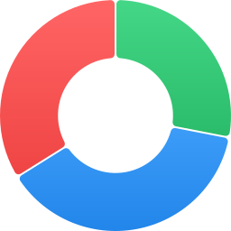

<p align="center"></p>

# OCharts

TypeScript canvas charts: plot, pie, gauge, treemap, segmented bar, tree bar and heat map.

## Installation

### Script tag

Add the styles and the script via [jsDelivr](https://www.jsdelivr.com/). The script defines the global `OCharts`.

```html
<link rel="stylesheet" href="https://cdn.jsdelivr.net/gh/kerssdead/charts@2.1.222/dist/main.css">
<script src="https://cdn.jsdelivr.net/gh/kerssdead/charts@2.1.222/dist/ocharts.js"></script>
```

### Bundler

The package ships an ES module with types. Load the styles `dist/main.css` separately.

```ts
import OCharts, { ChartType } from 'charts'
import 'charts/dist/main.css'

const chart = OCharts.chart(element, { type: ChartType.Pie, data: { values: [] } })
```

Supported browsers: Chrome and Edge 99+, Firefox 112+, Safari 16+.

## Usage

```html
<div id="chart" style="height: 320px"></div>

<script>
    const chart = OCharts.chart(document.getElementById('chart'), {
        type: 'pie',
        data: {
            values: [
                { label: 'North', value: 40 },
                { label: 'South', value: 25 },
                { label: 'East', value: 20 },
                { label: 'West', value: 15 }
            ]
        }
    })

    chart.render()
</script>
```

The chart fills its container. If the container has no height, a fallback height is used. Set `width` and `height` in the options to size it.

### Several charts in one container

Pass `charts` instead of `type` and `data`. A chart item has its own `type` (default `'plot'`), `title` and `data`. `columns` sets the number of columns in the grid.

```js
OCharts.chart(element, {
    title: 'Regional overview',
    enableLegend: true,
    columns: 2,
    charts: [
        { type: 'pie', title: 'Share', data: { values: [{ label: 'North', value: 40 }, { label: 'South', value: 25 }] } },
        { type: 'gauge', title: 'Target', data: { values: [{ label: 'Done', value: 72 }], min: 0, max: 100 } }
    ]
})
```

Use either `type` with `data`, or `charts`. TypeScript rejects mixing them.

## Chart types

| `type` | Chart |
|---|---|
| `'plot'` (default) | Line, column, bar and area series |
| `'pie'` | Pie and donut |
| `'gauge'` | Gauge |
| `'tree-map'` | Treemap |
| `'segmented-bar'` | Segmented bar |
| `'tree-bar'` | Expandable tree of bars |
| `'heat-map'` | Heat map |

In TypeScript you can also use the `ChartType` enum, for example `ChartType.Pie`.

### Example

```js
{
    type: 'plot',
    data: {
        xType: 'number',     // 'number' | 'date' | 'text'
        xScale: 'linear',    // 'category' | 'linear' | 'log'
        yScale: 'linear',
        xTitle: 'Month',
        yTitle: 'Revenue',
        values: [
            { type: 'line', label: 'North', width: 2, values: [{ x: 1, y: 12 }, { x: 2, y: 18 }] },
            { type: 'column', label: 'South', values: [{ x: 1, y: 10 }, { x: 2, y: 14 }] }
        ]
    }
}
```

Series `type`: `'line'` (default), `'attention-line'`, `'column'`, `'bar'`, `'stacking-column'`, `'area'`. A line series also takes `drawMode: 'straight' | 'smooth'`, `width` and `dash`.

### Heat map

Cells are drawn as a grid colored from light to dark `color`, with a gradient scale under the map. There are two ways to give the data.

Labeled cells: one cell per `x` and `y` label. `xLabels` and `yLabels` set the order (default: first appearance), and a missing cell stays empty. A repeated `x` and `y` keeps the last value.

```js
{
    type: 'heat-map',
    data: {
        xTitle: 'Weekday',
        yTitle: 'Hour',
        xLabels: ['Mon', 'Tue'],
        yLabels: ['0h', '12h'],
        values: [{ x: 'Mon', y: '0h', value: 2 }, { x: 'Mon', y: '12h', value: 14 }, { x: 'Tue', y: '0h', value: 3 }]
    }
}
```

Points: set `resolution` and give numeric `x` and `y`. Points are summed into a grid of `resolution` columns (rows follow the aspect ratio), or `{ columns, rows }`. The coordinate range is `width` by `height`, which default to the image size, or to the largest point.

```js
{
    type: 'heat-map',
    data: {
        image: 'plan.png',   // drawn under the map
        resolution: 40,
        opacity: 0.8,        // strongest cell opacity over an image
        values: [{ x: 312.5, y: 144, value: 3 }]
    }
}
```

Other settings: `color` (base color), `colors` (a gradient of several colors from low to high, for example `['#0000ff', '#00ff00', '#ff0000']`), `disableAxes` (labeled cells only, hides labels and titles). Cells have no gaps or rounded corners.

Each labeled cell also takes `label` (the tooltip title, default `'y / x'`), `color` (its own color instead of the gradient) and `data` (passed to the custom tooltip template and to context menu actions of that cell).

`smooth: true` draws a continuous field instead of cells, for both kinds of data. For points, `radius` (in the same units as `x` and `y`) sets how far each point spreads; the default is one and a half grid cells, and overlapping points add up. A missing labeled cell counts as the lowest value.

`alive: true` (smooth points only) keeps the field moving after the intro: each hot spot slowly breathes, and the area under the pointer takes up extra heat. It redraws every frame while the chart is visible, and does nothing with `staticMode` or reduced motion.